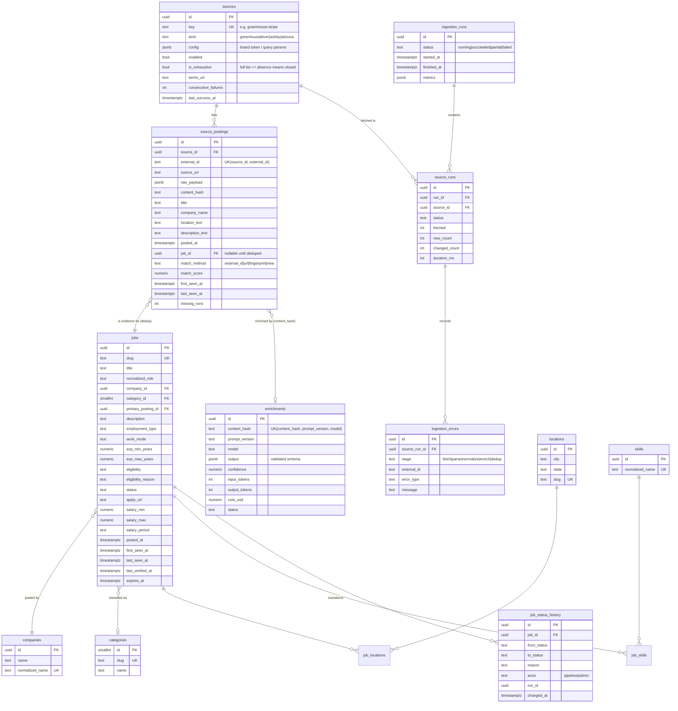
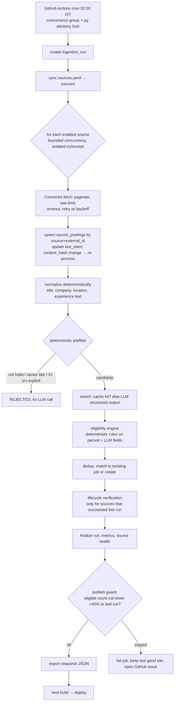
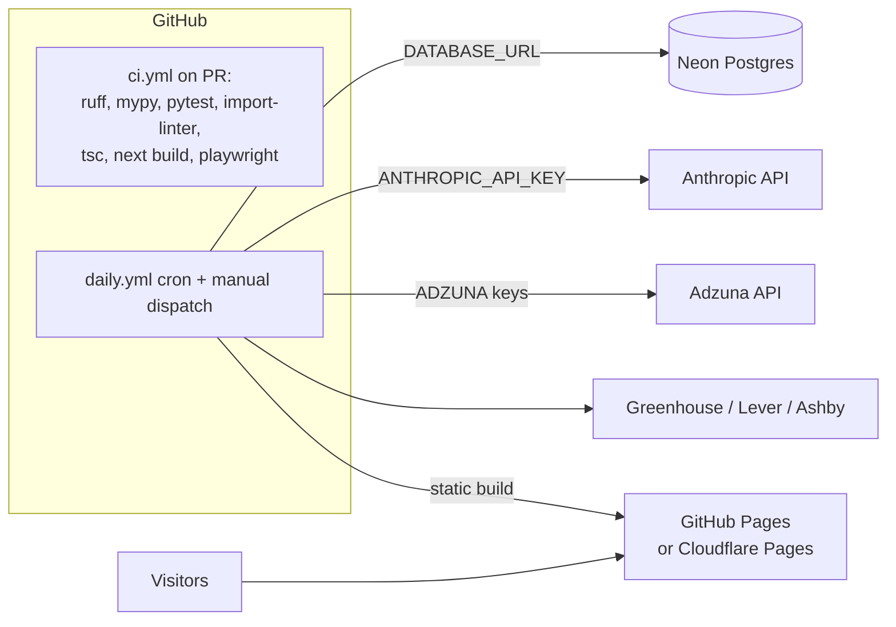

# RiseFirst — Architecture Proposal (v0, for approval)

Status: **SUPERSEDED IN PART (2026-11-19).** This was the pre-build design. The built system
differs in three ways, decided for the submission: (1) FastAPI + server-rendered Next.js run locally
with Docker Compose instead of the static-first export, (2) Gemini instead of Claude for AI tagging,
(3) no Adzuna source yet. See the root README for what is actually built.
Date: 2026-11-17

This document is the Step 1–4 deliverable: repository assessment, target architecture,
risks and an implementation plan. Once approved, its decisions move into the permanent
docs (ARCHITECTURE.md, ADRs, etc.), which will describe only what is actually built.

---

## 1. Repository assessment

| Item | Finding |
|---|---|
| Repository | `/Users/prateekkumar/RiseFirst` is **empty** and not a git repository. |
| Existing code, endpoints, schema, tests, CI | None. Nothing to preserve or migrate. |
| Local toolchain | Python 3.14, Node 24, Docker (running), PostgreSQL (accepting connections on :5432), `gh` CLI (authenticated). |
| Secrets present | No LLM, job-API or database credentials in the environment. |

**Consequence:** greenfield. There is no technical debt to manage, so the main risk is
the opposite one — building more than the problem needs.

## 2. Existing technology stack

None. The stack below is proposed from the brief and adjusted where the evidence in §3 says so.

## 3. Source investigation (live probes run today)

The product goal (200+ *fresher* listings in India) is decided by sourcing, not by
code. I probed the public, documented job-board APIs before designing anything.

### 3.1 What the employer ATS APIs actually return

| Source (public API) | Companies probed | India listings | Fresher-looking titles* |
|---|---|---|---|
| Greenhouse Job Board API | 10 with India hiring (Databricks, Stripe, MongoDB, Okta, Rubrik, Razorpay, Groww, Twilio, Coinbase, Druva) | ~410 | **~14** |
| Lever Postings API | Paytm, Meesho, CRED, Mindtickle (+19 that returned nothing) | ~250 | ~25–35 (many false positives such as "Associate Director") |
| Ashby Posting API | Sarvam, OpenAI, Notion, Ramp, Linear | ~60 | ~2 |

\*Title regex: intern / graduate / trainee / fresher / junior / entry / associate, excluding senior / lead / manager.

**Update (sourcing spike, same day):** a 418-company probe across Greenhouse, Lever, Ashby,
Workable and Recruitee found 74 boards with 1,524 India postings, of which **38 were
auto-eligible (2.5%)** and 115 need review. Realistic yield from ATS boards is about
60–150 publishable fresher jobs. Full results: `spikes/sourcing/REPORT.md`.

**Finding:** employer ATS boards have high data quality (full descriptions, direct
apply links, exhaustive lists so closures are detectable), but only **~5% of India
listings are fresher roles**. Reaching 200 eligible listings from ATS boards alone would
need roughly 100–150 curated companies, many of which (Swiggy, Zomato, PhonePe, CRED,
Freshworks…) do not use a public-API ATS. **ATS boards alone will not meet the 200 target.**

### 3.2 Compliance check (robots.txt / terms) per host

| Host | robots.txt / terms | Decision |
|---|---|---|
| `boards-api.greenhouse.io` | Only `/embed/` disallowed; API is publicly documented | **Use** |
| `api.lever.co` | `Allow: /`, `Crawl-delay: 1` | **Use**, ≤1 req/s |
| `api.ashbyhq.com` | No robots file; posting API publicly documented for job boards | **Use** |
| `api.smartrecruiters.com` | `Disallow: /` for all agents except LinkedInBot | **Exclude** (despite returning data: Swiggy, Bosch, Experian) |
| `api.adzuna.com` | `Disallow: /` for crawlers; access is via a **keyed developer API** under Adzuna's API terms (attribution + link-back) | **Use with a key**, under its API agreement — you need to sign up and accept the terms |
| LinkedIn, Naukri, Indeed, Internshala, Glassdoor, Foundit | Terms prohibit automated collection | **Exclude** |
| Workday career sites (`*.myworkdayjobs.com`) | Undocumented internal JSON endpoint | **Exclude** unless an employer publishes it as permitted |

### 3.3 Sourcing strategy (recommended)

1. **Adzuna India API** (keyed, free tier) — the volume source. It covers all domains
   (marketing, finance, HR, ops — which ATS boards in tech barely cover). Queries:
   `fresher`, `internship`, `graduate trainee`, `entry level`, `0-2 years` × category terms.
   Limitation: it returns a **description snippet**, not the full text, and its apply URL is
   an Adzuna redirect. We show the snippet with attribution and link out; we never
   rewrite or pad it.
2. **Curated ATS boards** (Greenhouse / Lever / Ashby; ~30–50 companies to start, in a
   reviewed `sources.yaml`) — the quality source: full descriptions and direct apply
   links. Also preferred as the canonical record when Adzuna re-lists the same job.
3. Later candidates, each needing a terms review first: Jooble API (keyed), government
   apprenticeship/NCS feeds if a permitted feed exists.

**I cannot verify Adzuna's India fresher volume without a key.** That is the main risk to
the 200 target (see §12).

---

## 4. Recommended target architecture

### 4.1 Key decision: static-first delivery, no always-on backend in v1

**WHAT:** A daily batch pipeline (Python) writes to PostgreSQL. It then exports a
read-only snapshot that a **Next.js static export** builds into a static site
(each job, category and city gets a pre-rendered page). Search runs in the browser over a
compact index. No FastAPI server runs in production in v1.

**WHY:**
- Data changes **once a day**. A server answering every request would mostly re-serve
  the same answers.
- 200–500 active jobs give a search index of about 50–80 KB gzipped, so in-browser search is
  instant and costs nothing.
- Pre-rendered HTML is better for SEO than client-rendered pages, and as good as SSR.
- No server means no server to secure, patch, scale or pay for. A failed pipeline run
  leaves the last good site live. That is graceful degradation for free.
- Infrastructure cost is roughly **$0/month** (plus LLM usage).

**ALTERNATIVES:**
- (B) FastAPI + Postgres FTS + Next.js SSR on Render/Fly/AWS App Runner (~$15–30/mo plus
  operations). This is the brief's original shape. Better when data must be live per
  request or users have accounts.
- (C) Postgres + Elasticsearch. Not justified below ~100k documents.

**WHEN TO CHANGE:** if active jobs exceed ~5,000 (the index gets too large for the
browser), if we need user accounts, saved searches or alerts, or if we need a web admin
UI. Then we add FastAPI in front of the **same** Postgres schema (the FTS column and
index are already designed, §6) and switch Next.js to ISR. The domain and application
layers don't change. Only a new presentation adapter is added.

### 4.2 Layers (Clean / Hexagonal, kept light)

```
domain/          Pure Python. Entities, value objects and rules: experience parsing,
                 eligibility, lifecycle state machine, dedup matching.
                 No imports of SQLAlchemy, httpx, anthropic or pydantic-settings.
application/     Use cases (RunIngestion, EnrichPendingPostings, VerifyLifecycle,
                 ExportSnapshot, ReviewJob) + ports (typing.Protocol):
                 SourceConnector, JobRepository, Enricher, Clock, SnapshotWriter.
infrastructure/  Adapters: connectors (httpx), SQLAlchemy repositories, the Anthropic
                 enricher, the snapshot writer, settings.
entrypoints/     CLI (Typer): `ingest`, `export`, `review`, `sources`, `runs`.
                 In phase 2 a FastAPI app sits here too and calls the same use cases.
```

Dependency rule: `entrypoints → application → domain`, with `infrastructure` implementing
`application` ports. This is enforced in CI with `import-linter`. That is a cheap check,
and it stops architecture erosion that review alone misses.

What I deliberately **don't** add: a DI container (constructor injection wired in one
`composition.py` is enough), a CQRS or event bus, generic repositories, or microservices.

---

## 5. Proposed folder structure

```
RiseFirst/
├── backend/
│   ├── pyproject.toml              # uv-managed; ruff, mypy --strict, pytest, import-linter
│   ├── alembic.ini
│   ├── migrations/                 # Alembic revisions
│   ├── src/risefirst/
│   │   ├── domain/
│   │   │   ├── models.py           # JobPosting, CanonicalJob, value objects (ExperienceRange, Location, Salary)
│   │   │   ├── enums.py            # JobStatus, Eligibility, EmploymentType, WorkMode, Category
│   │   │   ├── experience.py       # deterministic experience-text parser
│   │   │   ├── eligibility.py      # ELIGIBLE / REVIEW_REQUIRED / REJECTED rules
│   │   │   ├── lifecycle.py        # allowed status transitions
│   │   │   ├── dedup.py            # fingerprints, canonical URL, similarity, match decision
│   │   │   ├── normalization.py    # title/company/location normalisation, India city gazetteer
│   │   │   └── errors.py
│   │   ├── application/
│   │   │   ├── ports.py            # Protocols
│   │   │   ├── run_ingestion.py
│   │   │   ├── enrich_postings.py
│   │   │   ├── verify_lifecycle.py
│   │   │   ├── export_snapshot.py
│   │   │   └── review_jobs.py
│   │   ├── infrastructure/
│   │   │   ├── http/client.py      # timeouts, retries + backoff, per-host rate limit, host allowlist (SSRF)
│   │   │   ├── connectors/         # greenhouse.py, lever.py, ashby.py, adzuna.py, registry.py
│   │   │   ├── llm/                # anthropic_enricher.py, prompts/v1.py, schema.py, pricing.py
│   │   │   ├── persistence/        # tables.py (SQLAlchemy), repositories.py, locking.py
│   │   │   └── export/             # snapshot_writer.py (JSON for the web build)
│   │   ├── composition.py          # wires adapters into use cases
│   │   ├── config.py               # pydantic-settings, validated at startup
│   │   └── cli.py
│   └── tests/
│       ├── unit/                   # domain + application with fakes
│       ├── integration/            # Postgres (docker), connectors on recorded fixtures, migrations
│       └── fixtures/               # recorded API payloads (no live calls in CI)
├── web/                            # Next.js (App Router, TS strict, static export)
│   ├── app/                        # /, /jobs, /jobs/[slug], /category/[slug], /city/[slug], /about, /privacy, /terms
│   ├── components/                 # JobCard, Filters, SearchBar, Pagination…
│   ├── lib/                        # typed snapshot loader, search index (MiniSearch), filters
│   ├── tests/e2e/                  # Playwright against a fixture snapshot
│   └── package.json
├── config/
│   └── sources.yaml                # source registry (reviewed in PRs: compliance notes, terms URL)
├── docs/                           # the 11 required docs + adr/
├── .github/workflows/
│   ├── ci.yml                      # lint, types, tests (backend + web) on every PR
│   └── daily.yml                   # scheduled pipeline + build + deploy
├── docker-compose.yml              # local Postgres only
└── .env.example
```

**Source registry in YAML, health in the DB:** *what* we may collect is a reviewed,
version-controlled decision (git history gives the compliance audit trail). *How it is
doing* (failures, last success) is runtime state, so it lives in the DB. The pipeline
syncs YAML → `sources` at run start.

---

## 6. Database design (PostgreSQL)

### 6.1 ER diagram



### 6.2 Decisions and trade-offs

- **`source_postings` (one row per listing per source) vs `jobs` (one canonical
  opportunity):** this is the dedup boundary. Provenance is kept: every canonical job
  can list its source records and how each was matched (`match_method`, `match_score`).
  Raw payload sits on the same row as its normalised fields, because they are 1:1 and
  the normalised fields are re-derivable from it (re-normalise = re-run on `raw_payload`).
- **`enrichments` keyed by `(content_hash, prompt_version, model)`:** this is the LLM
  cache. An unchanged description never calls the LLM again. Bumping the prompt version
  re-enriches deliberately.
- **Enums as `text` + CHECK constraints** rather than Postgres ENUM types, because ENUM
  migrations are painful in Alembic.
- **JSONB only for** raw payloads, LLM output (an audit copy; the fields used for
  filtering are copied into typed columns) and run metrics.
- **No `roles` table yet** (YAGNI). `normalized_role` is text from a controlled prompt
  vocabulary. Promote it to a table when role landing pages exist.
- **No `admin_users` yet.** The v1 admin surface is a CLI whose access control is
  possession of `DATABASE_URL` (see §11). The table comes with the web admin in phase 2.
- **Search columns (phase 2):** `jobs.search_vector tsvector GENERATED` + a GIN index,
  added when the FastAPI search endpoint arrives. Not before, because nothing would query it.
- **UUIDs** for all externally referenced rows. Smallint for the seeded `categories`.

**Hosting:** **Neon serverless Postgres (free tier)** is recommended. Plain Postgres,
reachable from GitHub Actions, autosuspends between runs, and holds ~0.5 GB (enough for
years of this data). Backups: a nightly `pg_dump` uploaded as a 30-day GitHub Actions
artifact, in addition to Neon's own short restore window.
*Alternatives:* Supabase or RDS (RDS is ~$15+/mo, worth it only with an AWS commitment).
SQLite committed to git (rejected: binary diffs, no concurrent access, poor upgrade path).

---

## 7. Ingestion pipeline

### 7.1 Daily flow



### 7.2 Connector contract

```python
class SourceConnector(Protocol):
    kind: ClassVar[str]
    def fetch(self, source: SourceConfig) -> Iterator[RawPosting]: ...
```

`RawPosting` carries `external_id`, `url`, `payload`, plus the fields the connector can
map directly. Connectors only fetch and map. They do no DB access, eligibility or dedup.
Adding a source type is one new file plus a registry entry (OCP). Adding a company is a
YAML line.

### 7.3 Reliability rules

- **Per-source isolation:** a connector exception becomes a `source_runs.status=failed` row
  plus an `ingestion_errors` row. The run continues. The run status is `partial` if any
  source failed, `failed` only if all did.
- **Idempotency:** everything is an upsert on natural keys (`source_id, external_id`;
  `content_hash`). Re-running a day is safe. **Recovery** after an interrupted run: the
  next run sees a `running` row older than 2 h, marks it `failed`, and starts normally.
  Each stage selects work by state (e.g. "postings with no enrichment for current
  prompt_version"), so nothing depends on in-memory progress.
- **Duplicate-execution protection:** a GitHub Actions `concurrency` group **and** a
  Postgres advisory lock (belt and braces: manual dispatch plus cron could overlap).
- **HTTP:** a single `httpx` client with connect/read timeouts, exponential backoff with
  jitter on 429/5xx/network errors (max 3), honouring `Retry-After`, a per-host rate limit
  (Lever 1 req/s), and an **outbound host allowlist** derived from source kinds (SSRF
  guard: connectors can't be pointed at arbitrary URLs, even via YAML).
- **Response validation:** each connector parses payloads into Pydantic models. A schema
  drift becomes a recorded parse error for that posting, not a crash.

### 7.4 Lifecycle and closure detection

States: `DISCOVERED → PROCESSING → {PUBLISHED | REVIEW_REQUIRED | ARCHIVED}`;
`PUBLISHED → {CLOSED | EXPIRED}`; `REVIEW_REQUIRED → {PUBLISHED | ARCHIVED}` (admin);
`CLOSED/EXPIRED → ARCHIVED` after 90 days; a re-seen closed job → `PROCESSING`.
Every transition is validated by `domain/lifecycle.py` and written to `job_status_history`.

- **Exhaustive sources (ATS boards):** the board lists *all* open jobs. A posting absent
  from **2 consecutive successful** fetches → `CLOSED`. A failed fetch changes nothing.
- **Non-exhaustive sources (Adzuna search):** absence from search results proves nothing.
  These jobs get `EXPIRED` when no source has seen them for 21 days, or when 45 days have
  passed since `posted_at`. This is a heuristic and is documented as one. A canonical job
  is closed only when **all** its source records are closed or expired.
- **Apply-link verification:** phase 2 (HEAD/GET with redirect limit and host allowlist).
  Some ATS hosts block HEAD requests, so v1 relies on board presence.

---

## 8. AI enrichment architecture

### 8.1 Deterministic first, LLM second

| Field | How |
|---|---|
| India filter, city/state | Gazetteer + alias table (Bangalore/Bengaluru, Gurgaon/Gurugram, NCR…) first. **LLM only when the text is ambiguous.** |
| Experience | Regex parser for "0-2 yrs", "0 to 2 years", "up to 2", "2+", "minimum 2", "freshers". The LLM extracts it too, and **disagreement → REVIEW_REQUIRED**. |
| Employment type | Source field / title keywords (intern, apprentice, trainee); LLM fallback |
| Category, normalised role, skills, work mode, eligibility signals, salary | LLM (structured) |
| Senior/obviously ineligible | Title rules **before** the LLM (saves ~60–80% of calls) |

### 8.2 Provider abstraction

```python
class Enricher(Protocol):
    def enrich(self, posting: EnrichmentInput) -> EnrichmentResult: ...
```

`EnrichmentResult` is a domain dataclass (fields + confidence + usage). The Anthropic
adapter is the only module importing `anthropic`. Swapping providers = one new adapter.
A `FakeEnricher` drives all non-live tests.

### 8.3 Anthropic adapter

- `client.messages.parse()` with a **Pydantic output schema** (structured outputs), so
  responses are schema-valid by construction and validated again on our side.
- Prompt in versioned modules (`prompts/v1.py`, `PROMPT_VERSION = "v1"`). Category and
  role vocabularies are enumerated in the schema, so the model can't invent categories.
- **Prompt-injection posture:** the job text is untrusted. It goes in the user turn,
  delimited, with a fixed system prompt stating that the content is data. The model has
  **no tools**, and the output is constrained to the schema. Even a successful injection
  can only produce wrong field values, which the deterministic eligibility rules and
  confidence thresholds then catch.
- Records: model, prompt_version, input/output tokens, computed cost, latency.
  Per-run totals go into run metrics.
- Retries: the SDK's built-in retries (429/5xx). A validation failure → one retry, then
  `status=failed` and the job is not published. Reprocessed next run via
  `risefirst review reprocess --failed`.
- Bounded concurrency (e.g. 4). The system prompt is cached (prompt caching).
- **Confidence:** the model returns per-field confidence. Below 0.7 on category or
  eligibility signals → `REVIEW_REQUIRED`.

### 8.4 Model choice and cost (your decision)

| Model | Price (in/out per 1M tokens) | Est. cost per posting (~1.5k in / ~400 out) | Est. monthly (≈150 new or changed candidates/day) |
|---|---|---|---|
| Claude Opus 5.5 (`claude-opus-5-5`) — most accurate | $4 / $20 | ~$0.014 | **~$60** (+ one-off backfill ~$20) |
| Claude Haiku 5.5 (`claude-haiku-5-5`) — cheapest | $0.10 / $0.50 | ~$0.0004 | **~$2** |

These are estimates. Real token counts will be measured in milestone 5. The task is
extraction and classification from short texts, where the small model is typically
adequate. The plan is to **measure both** on ~50 hand-labelled postings (a one-off spend
of under $1) and pick the cheaper model if its accuracy holds. The Message Batches API
(50% off) is a further option, since the pipeline isn't latency-sensitive.

### 8.5 Eligibility engine (deterministic, in `domain/eligibility.py`)

| Case | Result |
|---|---|
| Internship / apprenticeship / graduate-trainee programme in India | ELIGIBLE |
| Explicit range with min ≤ 1 and max ≤ 3 ("0–2", "0–1", "up to 2", "1–3") | ELIGIBLE |
| "Freshers", "entry level", "new grad", "0 years" stated explicitly | ELIGIBLE |
| "Minimum 2 years", "2+ years", "2–4 years" (min = 2) | REVIEW_REQUIRED (borderline for the 0–2 audience, so a human decides; tunable) |
| min ≥ 3, or senior/lead/manager/principal title | REJECTED |
| Experience not specified and no explicit junior signal | REVIEW_REQUIRED (never auto-eligible) |
| Parser and LLM disagree, or LLM confidence < 0.7 | REVIEW_REQUIRED |
| Location not in India (and not India-eligible remote) | REJECTED |

Only `ELIGIBLE` (or admin-approved) jobs are published. The result plus a human-readable
`eligibility_reason` is stored for audit.

---

## 9. Deduplication strategy

Deterministic, tiered, conservative. **A false merge (hiding a real job) is worse than a
false duplicate.**

1. **Same source, same `external_id`** → same posting (upsert). Exact.
2. **Canonical apply URL** (lower-cased host, tracking params like `utm_*`, `gh_src`,
   `source` stripped, trailing slash dropped) equal → same job.
3. **Fingerprint** = normalised company + normalised title (lower-case, punctuation and
   seniority suffixes such as "- India" stripped) + city. A fingerprint match is a
   *candidate*, confirmed only if:
   - both have full descriptions → word-shingle Jaccard ≥ 0.8, **or**
   - one side is a snippet (Adzuna) → snippet is ≥ 0.9 contained in the other description
     **and** posted dates within 14 days.
4. **Never merge** when the two records carry different requisition IDs from the same
   ATS, or different cities. Several openings of "Software Engineer I" in two cities are
   two jobs.
5. **Canonical record preference:** ATS > aggregator (full text, direct apply link). The
   canonical job's `primary_posting_id` points to it. All sources remain linked, with
   `match_method` / `match_score` stored, so every merge is explainable and reversible.

**Not using embeddings / vector DB in v1:** at ~500 active jobs, deterministic matching is
explainable and testable. We revisit if a measured duplicate rate (from the
`review dupes` CLI sample) shows meaningful misses — and then use pgvector inside the
same Postgres, not a separate vector DB.

---

## 10. Frontend

- **Next.js App Router, `output: 'export'`, TypeScript strict, Tailwind CSS.**
- Pages: `/`, `/jobs` (search + filters, URL query state so results are shareable),
  `/jobs/[slug]`, `/category/[slug]`, `/city/[slug]`, `/about`, `/privacy`, `/terms`;
  `sitemap.xml`, `robots.txt`, canonical URLs, per-page metadata.
- Search: MiniSearch over a compact `index.json` (title, company, skills, city, category,
  flags). Full descriptions load only on detail pages.
- **Google JobPosting JSON-LD only for jobs with a full description** (ATS-sourced).
  Emitting it for snippet-only Adzuna listings would break Google's guidelines.
- Shown on every card and detail page: source + attribution ("via Adzuna"), posted date,
  **last verified date**. No invented fields: a missing value renders as "Not specified".
- Company logos: v1 shows a **text monogram**. Logos come later, only where licensing is clear.
- Accessibility: semantic HTML, keyboard-navigable filters, labelled controls; an axe
  check runs in Playwright.

---

## 11. Deployment, security and observability



- **Scheduler:** GitHub Actions cron. It's free, has logs and secrets, and needs no
  worker infra. Caveats: cron can start minutes late (fine for a daily job), and GitHub
  **disables scheduled workflows in public repos after 60 days without repo activity**.
  Mitigation: the run writes its summary to `$GITHUB_STEP_SUMMARY`, and a monthly
  keep-alive commit (or an external cron hitting `workflow_dispatch`) keeps it active.
  *Change when:* runs need more than hourly cadence or more than 6 h. Then use a
  container on a schedule (ECS scheduled task / Fly machine) running the same CLI.
- **Hosting:** GitHub Pages if the repo is public. GitHub Pages for private repos needs
  a paid plan, so use **Cloudflare Pages (free)** for a private repo.
- **Secrets:** GitHub Actions secrets only. `.env.example` lists names. `pydantic-settings`
  fails fast on missing config. Logs never include keys (a redacting log filter is
  unit-tested).
- **Admin (v1):** the `risefirst` CLI — `review list | show | approve | reject`,
  `sources status`, `runs list | show`, `reprocess --failed`, `dupes sample`. Every admin
  action is written to `job_status_history` with an `actor`. Access is controlled by DB
  credentials (Neon role with least privilege).
  *Change when:* more than one non-engineer reviewer is needed. Then add a FastAPI admin
  API + Next.js admin pages behind Cloudflare Access or OAuth with a role check, plus the
  `admin_users` table.
- **Rendering untrusted text:** descriptions are sanitised to a small HTML allowlist at
  export time (`nh3`), and rendered as sanitised HTML only.
- **Observability:** structured JSON logs (`structlog`) carrying `run_id`, `source_key`,
  `stage`. Per-run metrics go in `ingestion_runs.metrics`: fetched per source, new,
  changed, duplicates merged, eligible / review / rejected, LLM calls, tokens, cost,
  failures, closed, expired, duration. A Markdown run report goes to the Actions summary.
  **Critical failures** (all sources failed, publish guard tripped, 3 consecutive failures
  of one source) open or update a GitHub issue. `risefirst runs show <id>` diagnoses a
  run without reading code.
- **Supply chain:** Dependabot + `pip-audit` + `npm audit` in CI. Pinned lockfiles
  (`uv.lock`, `package-lock.json`).

---

## 12. Risks and trade-offs (challenging this design)

| Risk | Severity | Mitigation |
|---|---|---|
| **200 fresher listings may not be reachable from compliant sources.** ATS yield measured at ~5%; Adzuna India volume is unverified. | High | Verify Adzuna on day 1 of M3 with your key. Expand the curated ATS list. Report the real count honestly rather than loosening eligibility to inflate it. |
| Dependence on Adzuna as the volume source (single point of failure for count) | Medium | ATS sources keep the site alive. Jooble is a second aggregator candidate (terms review needed). |
| Adzuna snippets → thin detail pages, weaker LLM extraction, no JSON-LD | Medium | Show the snippet clearly as an excerpt plus "View full posting". Lower-confidence fields → REVIEW or "Not specified". |
| REVIEW_REQUIRED queue grows faster than anyone reviews it | Medium | Tune rules on real data in M5. Track queue size in run metrics. Auto-archive review items older than 30 days. |
| Heuristic expiry for aggregator jobs shows some closed jobs as open | Medium | Short windows (21/45 days), last-verified date shown on every listing, apply-link checks in phase 2 |
| GitHub cron disabled after 60 inactive days / delayed starts | Low | Keep-alive plus a staleness check (site shows data age; issue opened if more than 48 h old) |
| Neon free-tier limits or policy change | Low | Plain Postgres. `pg_dump` backups. Moving is a `DATABASE_URL` change. |
| Static site can't support accounts or alerts later | Low | The planned path (§4.1) adds FastAPI without touching domain or application code. |
| Overengineering | — | Cut list: no Redis, queue, Celery, Kafka, K8s, vector DB, Elasticsearch, DI container or microservices. Clean-architecture layers are kept, but each port has a reason to exist (a real second implementation or a test fake). |
| Legal: republishing employer job content | Medium | Official APIs only, attribution + link to source on every listing, takedown contact on /about, no logos without licence, honour any source's opt-out. |

---

## 13. Development roadmap (each milestone independently testable)

| # | Milestone | Key files | Tests | Acceptance |
|---|---|---|---|---|
| M0 | Scaffold | `backend/pyproject.toml`, `docker-compose.yml`, `.github/workflows/ci.yml`, `.env.example`, `web/` skeleton | CI runs empty suites green | `uv run pytest` and `npm run build` pass in CI |
| M1 | Domain core | `domain/*` | Unit: experience parser (30+ phrasings), eligibility table, lifecycle transitions, dedup matcher, location normalisation | 100% branch coverage on eligibility + lifecycle; no infrastructure imports (import-linter) |
| M2 | Persistence | `persistence/*`, `migrations/` | Integration on Postgres: migrations up/down, repositories, upsert idempotency, advisory lock | Fresh DB migrates. Re-running an upsert is a no-op. |
| M3 | Connectors | `http/client.py`, `connectors/*`, `config/sources.yaml` | Recorded-fixture tests per connector, pagination, 429/timeout/backoff, host allowlist rejects other hosts | Live smoke run (manual) fetches all configured sources. **Adzuna yield measured and reported.** |
| M4 | Ingestion use case | `application/run_ingestion.py`, `verify_lifecycle.py`, `cli.py` | With fake connectors: one source failing doesn't stop others; interrupted-run recovery; closure only after 2 successful misses | `risefirst ingest` end-to-end on local Postgres. Run metrics recorded. |
| M5 | AI enrichment | `llm/*`, `application/enrich_postings.py` | Fake-enricher unit tests, cache hit/miss, schema-failure path; **paid** eval on ~50 labelled postings (your approval first) | Measured accuracy per field and $/posting for both models; model chosen |
| M6 | Snapshot + website | `export/*`, `web/app/**` | Playwright: search, filters, detail page, apply link, 404; axe a11y; snapshot schema test | Lighthouse SEO/a11y ≥ 90 on fixture data |
| M7 | Operations + docs | `daily.yml`, publish guard, issue alerts, 11 docs + ADRs | Workflow dry-run against a staging DB | Site live, refreshes daily unattended. Count of eligible listings reported. |
| M8 | Admin CLI review flow | `application/review_jobs.py`, CLI | Approve/reject transitions + history | Review queue workable end-to-end |

Phase 2 (only when triggered): FastAPI public/admin API + auth, Postgres FTS, apply-link
verification, more sources, pgvector dedup if measured misses warrant it.

**Planned ADRs:** 001 static-first delivery · 002 Postgres (Neon) as system of record ·
003 GitHub Actions as scheduler · 004 source admission policy (official APIs, terms
review) · 005 deterministic-first classification · 006 deterministic dedup, no embeddings
· 007 client-side search in v1 · 008 CLI admin in v1.

---

## 14. Decisions needed before coding

1. **Delivery model:** static-first (recommended) or always-on FastAPI + SSR?
2. **Adzuna API key:** will you register (free)? Without it, the realistic v1 count is
   roughly 30–80 fresher listings, not 200.
3. **LLM:** Claude Opus 5.5 (default, ~$60/mo est.) or Claude Haiku 5.5 (~$2/mo est.),
   or measure both in M5 and decide on data? You'll need to provide an `ANTHROPIC_API_KEY`.
4. **Repo & hosting:** public repo + GitHub Pages, or private repo + Cloudflare Pages?
   Which GitHub account or org should own it?
